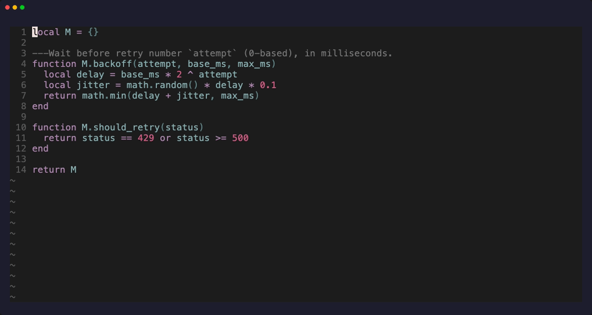

# askfn.nvim

Ask a coding agent about the function under your cursor, without leaving the buffer.



- `af` text object: the whole function, signature included (`vaf`, `yaf`, `daf`)
- `<leader>aq`: popup for a question about that function; in visual mode, about the selection
- `<leader>aQ`: the same, with the whole file sent along as context
- `<leader>at`: popup for a question about the class, struct, enum, trait or impl block around the cursor
- The answer streams into a floating window that grows with it; the asked code stays highlighted
- Follow-up questions in the same window, same agent session
- One key to continue the conversation in an interactive agent terminal
- Backends: [Claude Code](https://claude.com/claude-code) (default) or pi (experimental), or any CLI that takes a prompt as its last argument

No dependencies. Function boundaries come from the attached language server
(`textDocument/documentSymbol`), so no treesitter parsers are needed.

`<leader>at` asks about the whole enclosing type, found the same way. Which symbol kinds count: class, struct,
enum, interface (a Rust trait) and object (a Rust impl block). Code over 100 KB is not sent; the plugin says so
and you ask about a smaller part.

Dockerfiles have no functions, and Docker's language server reports every instruction as one, so there
the unit is the build stage: a `FROM` line down to the next one, named by its `AS` alias. This is found
by reading the text and needs no language server.

## Requirements

- Neovim 0.11+
- A language server attached to the buffer (for the function lookup; visual selection works without one)
- The agent CLI on your `PATH`

## Install

lazy.nvim:

```lua
{
  "0OZ/askfn.nvim",
  opts = {},
}
```

Anything else: put the plugin on your runtimepath and call `require("askfn").setup()`.

## Keys

| Where | Key | Does |
|---|---|---|
| normal | `<leader>aq` | ask about the function under the cursor |
| visual | `<leader>aq` | ask about the selection |
| normal / visual | `<leader>aQ` | as `<leader>aq`, and send the whole file as context |
| normal | `<leader>at` | ask about the class, struct, enum, trait or impl block around the cursor |
| visual / operator | `af` | the whole function including its signature |
| answer window | `<CR>` | ask a follow-up question |
| answer window | `o` | continue in an interactive agent terminal |
| answer window | `gy` | copy the last answer |
| answer window | `gY` | copy the first code block of the last answer |
| answer window | `q`, `<Esc>` | close; stops the agent if it is still answering |

Follow-up and terminal handoff wait until the current answer is complete.

With the Claude backend the terminal session starts in plan mode, because the question ran in it; Shift+Tab leaves it.

## Configuration

Defaults:

```lua
require("askfn").setup({
  backend = "claude",
  backends = {
    claude = {
      cmd = {
        "claude", "-p", "--model", "claude-sonnet-5-5", "--effort", "xhigh", "--permission-mode", "plan",
        "--output-format", "stream-json", "--verbose", "--include-partial-messages",
      },
      output = "claude-stream-json",
      session = { start = "--session-id", resume = "--resume", interactive = { "claude", "--resume" } },
    },
    pi = { cmd = { "pi", "-p", "--thinking", "xhigh" }, output = "text" },
  },
  keys = { -- any of them: false to disable
    ask = "<leader>aq",
    ask_file = "<leader>aQ",
    ask_type = "<leader>at",
    textobject = "af",
    follow_up = "<CR>",
    handoff = "o",
    yank = "gy",
    yank_code = "gY",
  },
  animate = true, -- grow the answer window smoothly; false jumps to the content height
  -- Opens the interactive agent; argv resumes the session that was just asked.
  handoff = function(argv)
    vim.cmd("botright vnew")
    vim.fn.jobstart(argv, { term = true })
    vim.cmd.startinsert()
  end,
})
```

The asked lines are highlighted with `AskfnTarget`, linked to `Visual` by default.

### Sending the whole file

`<leader>aq` sends the function (or selection), its path and its line range. An agent that can read files,
like Claude Code, can open the rest itself. `<leader>aQ` also puts the whole file in the first prompt, for
questions about code outside the function, or for files the agent cannot read from disk (an unsaved buffer).
It costs more tokens, so it is a separate key. Files over 100 KB are not sent (the prompt is a single
command-line argument and Linux caps those at 128 KB); you get a notice and the function only. Follow-up
questions reuse the session and do not resend the file.

### Backends

A backend is a table:

- `cmd`: argv of the CLI. The prompt (file path, line range, source and your question) is appended as the last argument.
- `output`: how the CLI writes its answer to stdout.
  - `"text"`: shown as it arrives.
  - `"claude-stream-json"`: Claude Code's `--output-format stream-json`; only the answer text is shown.
- `session` (optional): lets the plugin continue a conversation. Each first question runs under a fresh
  session id passed after `start`; follow-ups pass the same id after `resume`; `interactive` plus the id
  reopens the session in a terminal. Without `session` there is no follow-up and no handoff (pi, for now).

The Claude backend runs in plan mode (`--permission-mode plan`), so a question can read your code but never
edits it, whatever your own Claude settings say. Drop those two arguments from `cmd` if you want it to act.

Switch to pi with `backend = "pi"`.

### Handing off to claudecode.nvim

By default `o` opens the session in a terminal split. To resume inside
[claudecode.nvim](https://github.com/coder/claudecode.nvim) instead (this ends the Claude session it
currently has open):

```lua
handoff = function(argv)
  vim.cmd("ClaudeCodeClose")
  vim.cmd("ClaudeCode --resume " .. argv[#argv])
end,
```

## Demo

`assets/demo.gif` is recorded from a script, so it looks the same every time: a real language server,
a stand-in agent (`demo/fake-agent.sh`) that replies with fixed text. To re-record it (needs
[vhs](https://github.com/charmbracelet/vhs) and `lua-language-server`):

```sh
vhs demo/demo.tape
```

## Tests

```sh
nvim --headless -u NONE -l tests/run.lua
```

## License

MIT
